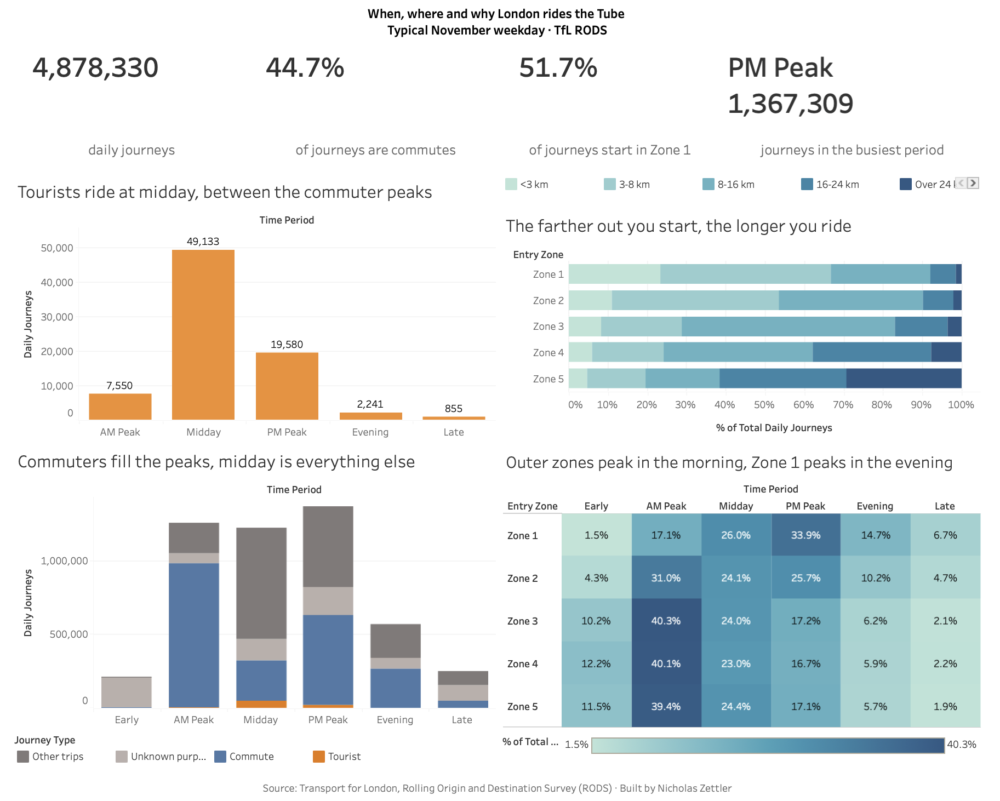

# London Underground Ridership Analysis (SQL + Tableau)

Exploratory SQL analysis of when, where, and why people ride the London Underground on a typical weekday.

- **Tools:** SQL (aggregation, multi-column `GROUP BY`, `WHERE` filtering, `ORDER BY`); Tableau Public (calculated fields, table calculations, Top N filter)
- **Context:** Case study completed in the Global Career Accelerator, summer 2026
- **Data:** Transport for London (TfL) Rolling Origin and Destination Survey (RODS), used as a training dataset

---

## Interactive dashboard

[](https://public.tableau.com/app/profile/nicholas.zettler/vizzes)

**[View the live dashboard on Tableau Public →](https://public.tableau.com/app/profile/nicholas.zettler/vizzes)**

Built in Tableau Public from the same 6,295-row RODS extract used in the SQL analysis below.

| View | What it shows | Tableau technique |
|---|---|---|
| KPI row | 4.88M daily journeys · 44.7% are commutes · 51.7% start in Zone 1 · PM Peak is busiest | Calculated fields, Top N filter |
| Zone × time heatmap | Each zone's day as % of its own journeys | Percent-of-total table calculation |
| Purpose by time | Commute vs. tourist vs. other trips across the day | `Journey Type` calculated field (IF/ELSEIF) |
| Trip length by zone | Distance mix for each entry zone | 100% stacked bars (table calculation) |
| Tourist timing | When tourist trips happen | Dimension filter |

### What the dashboard adds beyond the SQL

- **Zone 1 and the outer zones peak at opposite times.** Zone 1 entries peak in the PM (33.9% of its journeys vs. 17.1% in the AM). Zones 3–5 peak in the AM (about 40%) and fall to about 17% in the PM: people leave home from the outer zones in the morning and leave work in Zone 1 in the evening.
- **Commuters dominate the AM peak.** 77.5% of AM Peak journeys are Home↔Work commutes, against 22.5% at midday.
- **Tourists fill the gap between peaks.** 61.9% of tourist journeys happen at midday.
- **Early trips are mostly unlabeled.** 96.9% of Early journeys have an unknown purpose, a data-quality limit worth noting.

---

## Question

How do journey volume, timing, and trip purpose vary across the Underground network, and what would that suggest for service planning?

## Data

- 6,295 rows, modeling a typical November weekday
- Columns: `entry_zone` (Zones 1-5), `time_period` (Early, AM Peak, Midday, PM Peak, Evening, Late), `origin_purpose`, `destination_purpose` (Home, Work, Shop, Education, Tourist, Hotel, Other, Unknown), `distance` (5 bands), `daily_journeys`
- `daily_journeys` is a modeled estimate, not a count from a single day of observation

## Analysis

### 1. Overall usage

```sql
SELECT SUM(daily_journeys) AS total_journeys
FROM tfl.rods;
```
**Result:** 4,878,330 journeys on a typical day.

```sql
SELECT entry_zone, SUM(daily_journeys) AS total_journeys
FROM tfl.rods
GROUP BY entry_zone;
```
**Result:** 51.7% of journeys start in Zone 1.

```sql
SELECT time_period, SUM(daily_journeys) AS total_journeys
FROM tfl.rods
GROUP BY time_period
ORDER BY total_journeys DESC;
```
**Result:** PM Peak is the highest-volume period.

### 2. Why people ride

```sql
SELECT origin_purpose, destination_purpose, SUM(daily_journeys) AS total_journeys
FROM tfl.rods
GROUP BY origin_purpose, destination_purpose
ORDER BY total_journeys DESC;
```
**Result:** The two most common origin-destination pairs are Home-to-Work and Work-to-Home, so the network is used mainly for commuting.

### 3. Timing by purpose

```sql
SELECT origin_purpose, time_period, SUM(daily_journeys) AS total_journeys
FROM tfl.rods
GROUP BY origin_purpose, time_period
ORDER BY origin_purpose, total_journeys DESC;
```
**Result:** Trips starting at Home cluster in the AM Peak; trips starting at Work cluster in the PM Peak.

### 4. Purpose by zone

```sql
SELECT entry_zone, origin_purpose, SUM(daily_journeys) AS total_journeys
FROM tfl.rods
GROUP BY entry_zone, origin_purpose
ORDER BY entry_zone, total_journeys DESC;
```
**Result:** Work is the top origin purpose in Zone 1; Home is the top in Zones 2-5. This is consistent with a central business district surrounded by residential areas.

### 5. Tourist travel

```sql
SELECT origin_purpose, destination_purpose, time_period, SUM(daily_journeys) AS total_journeys
FROM tfl.rods
WHERE origin_purpose = 'Tourist' OR destination_purpose = 'Tourist'
GROUP BY origin_purpose, destination_purpose, time_period
ORDER BY total_journeys DESC;
```
**Result:** Tourist trips concentrate at Midday, unlike commuter trips, which concentrate in the AM and PM peaks.

## Findings summary

| Finding | Detail |
|---|---|
| Scale | ~4.9M journeys on a typical weekday |
| Geographic concentration | 51.7% of trips start in Zone 1 |
| Peak demand | PM Peak has the highest volume |
| Dominant use | Home/Work commuting |
| Zone profile | Zone 1 skews work; Zones 2-5 skew home |
| Off-peak demand | Tourist travel peaks at Midday |

## Recommendation

Concentrate service frequency into Zone 1 during the AM and PM commute windows, where demand is highest. Midday capacity in central zones could be tuned separately for tourist demand.

## Limitations

- Figures come from a modeled typical weekday in November, so they may not hold for other seasons or days.
- Distances are grouped into bands, which limits fine-grained trip-length analysis.
- Descriptive analysis only: it shows association, not cause, and no forecasting was done.
- 16.1% of journeys have an unknown purpose, concentrated in the Early period, so purpose-based findings for early morning are unreliable.
